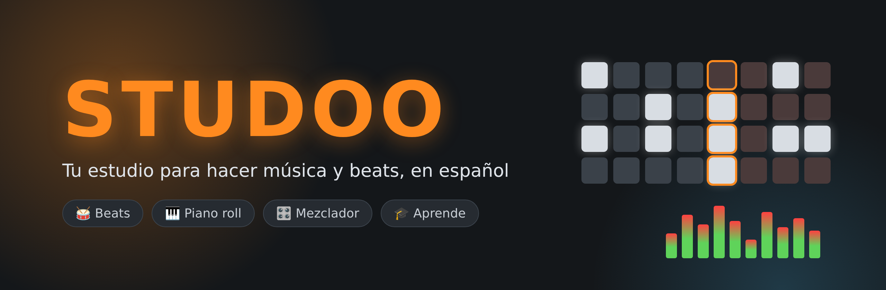
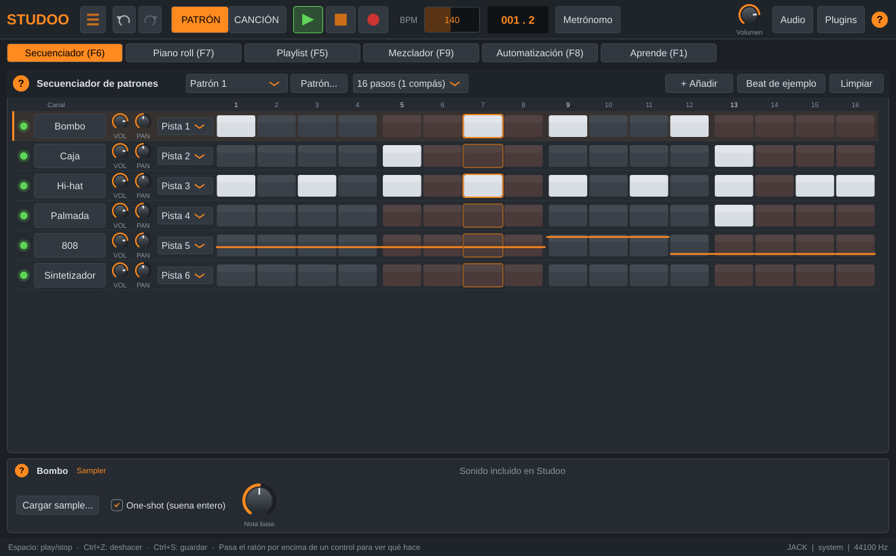
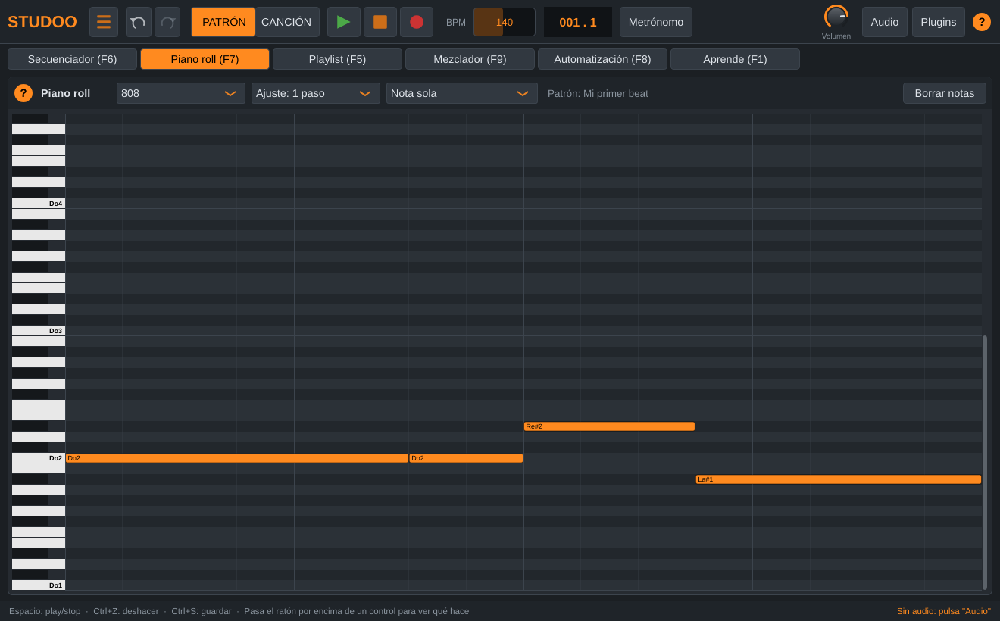
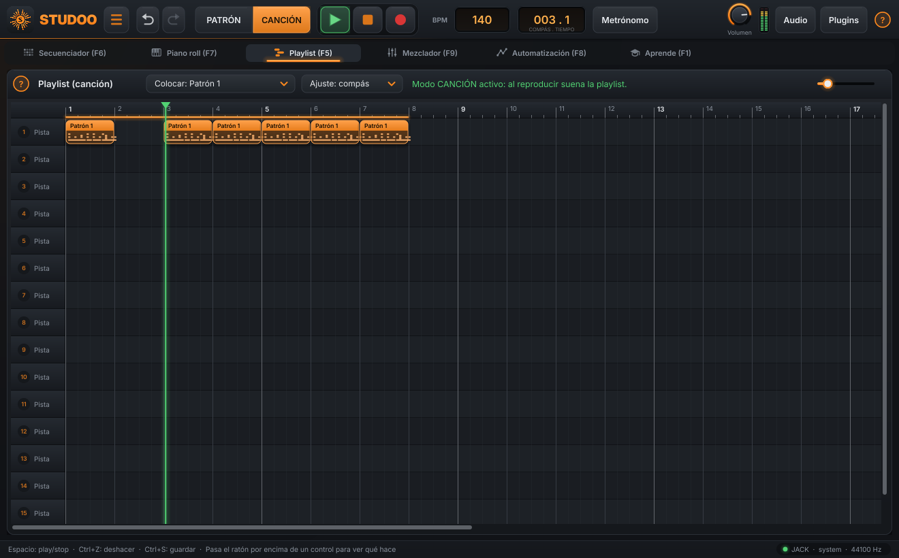
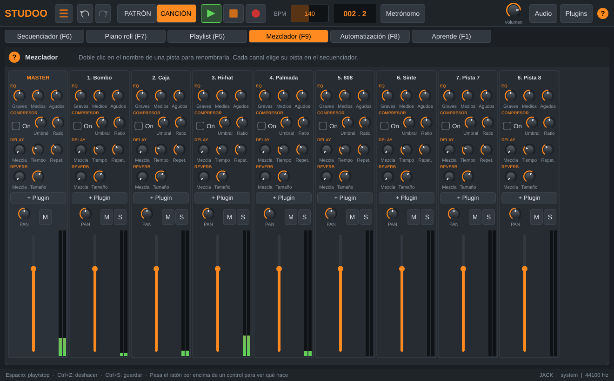
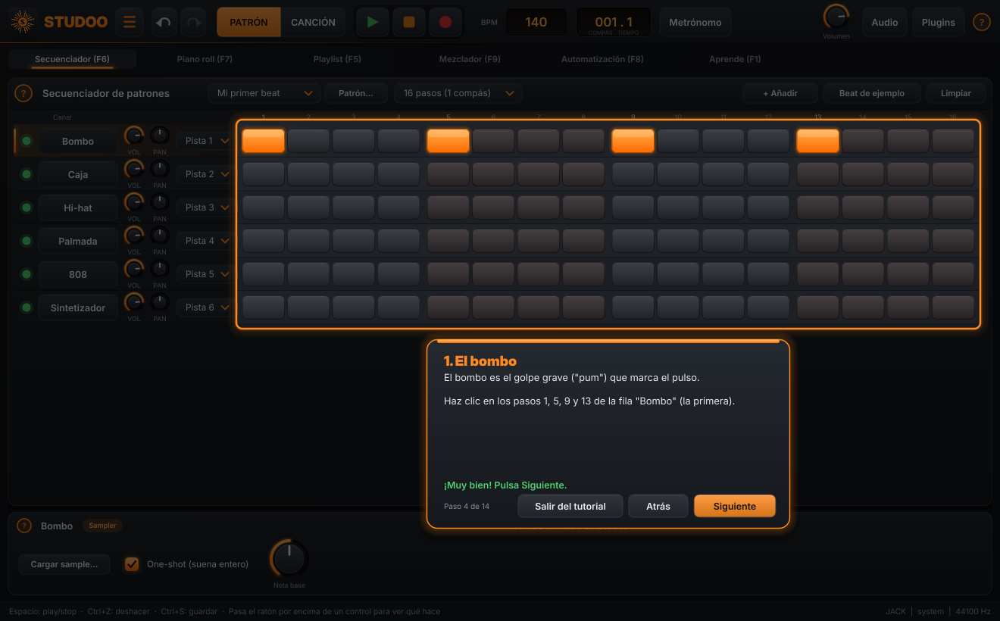
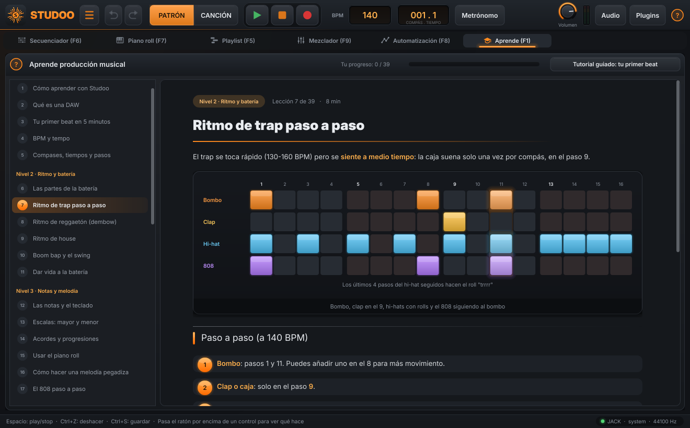

<p align="center">
  
</p>

<p align="center">
  
  
  
  
</p>

<h3 align="center">Haz beats, escribe melodías, graba tu voz y mezcla tu canción.<br>Todo en español, y aprendiendo mientras produces. 🎶</h3>

---

## 🎬 Así es Studoo

<table>
  <tr>
    <td width="50%"><p align="center"><b>🥁 Secuenciador de patrones</b><br>Crea ritmos encendiendo pasos</p></td>
    <td width="50%"><p align="center"><b>🎹 Piano roll</b><br>Melodías, acordes y 808 nota a nota</p></td>
  </tr>
  <tr>
    <td><p align="center"><b>🧩 Playlist</b><br>Coloca los patrones y monta la canción</p></td>
    <td><p align="center"><b>🎛️ Mezclador</b><br>EQ, compresor, delay y reverb en cada pista</p></td>
  </tr>
  <tr>
    <td><p align="center"><b>🧭 Tutorial guiado</b><br>Tu primer beat, paso a paso</p></td>
    <td><p align="center"><b>🎓 Aprende</b><br>39 lecciones con ilustraciones animadas, de cero a terminar canciones</p></td>
  </tr>
</table>

## ✨ Todo lo que puedes hacer

| | Función | Dónde |
|---|---|---|
| 🥁 | Secuenciador de patrones (16/32/64 pasos) y varios patrones | **Secuenciador** (F6) |
| 🎹 | Piano roll con ayudante de acordes, ideal para el 808 | **Piano roll** (F7) |
| 🧩 | Playlist para montar la canción completa | **Playlist** (F5) |
| 📂 | Tus samples (WAV, MP3, AIFF, FLAC, OGG) y kits de batería, arrastrando archivos | **+ Añadir** |
| 🥁 | **18 kits de batería incluidos** (más de 200 sonidos): Trap, Drill, Boom Bap, Reggaetón, House, Lo-fi, Phonk, Afrobeat, Dancehall, R&B, Techno, Jersey Club, Dubstep, Pop, Synthwave, Clásico 808, Clásico 909 y Percusión latina. Cambia de kit sin perder tu ritmo | **+ Añadir** |
| 💥 | **Efectos FX** (subidas, impactos, caídas de sub...), **14 sonidos de sintetizador** ya preparados y **6 tipos de 808** | **+ Añadir** |
| 🎸 | Instrumentos: **sampler**, **sintetizador** y **808** con glide | **+ Añadir** |
| 🎛️ | Mezclador: volumen, panorama, mute/solo, **EQ, compresor, delay y reverb** | **Mezclador** (F9) |
| 📈 | Automatización de volumen, panorama, efectos y filtro | **Automatización** (F8) |
| 🎙️ | Grabación de voz con el micrófono | Botón rojo o tecla **R** |
| 🔌 | Plugins **VST3** (instrumentos y efectos) | Botón **Plugins** |
| 🎹 | Teclados y controladores **MIDI** | Botón **Audio** |
| 💾 | Guardar y abrir proyectos, con **autoguardado** cada minuto | Menú ☰ |
| 🔄 | **Se actualiza solo**: avisa cuando hay una versión nueva y la instala con un clic | Al abrir, o menú ☰ |
| ↩️ | Deshacer y rehacer (**Ctrl+Z / Ctrl+Y**) | Barra superior |
| 💿 | Exportar a **WAV** y **MP3** | Menú ☰ |
| ⏱️ | BPM, metrónomo, modos PATRÓN/CANCIÓN y atajos de teclado | Barra superior |
| 🎓 | **Aprende**: ruta de 39 lecciones en 7 niveles con ilustraciones animadas, pasos, ejercicios, vídeos y progreso. Además, tutorial guiado, botón **?** en cada sección y mensajes de ayuda | **Aprende** (F1) |

## ⌨️ Atajos principales

| Tecla | Acción | | Tecla | Acción |
|---|---|---|---|---|
| `Espacio` | Reproducir / parar | | `F5` | Playlist |
| `L` | Modo PATRÓN ↔ CANCIÓN | | `F6` | Secuenciador |
| `R` | Grabar | | `F7` | Piano roll |
| `Ctrl+Z` / `Ctrl+Y` | Deshacer / rehacer | | `F8` | Automatización |
| `Ctrl+S` | Guardar | | `F9` | Mezclador |
| `Ctrl+E` | Exportar a WAV | | `F1` | Aprende |

---

## 📥 Descargar e instalar Studoo

👉 Ve a **[Releases](../../releases/latest)** (a la derecha de la página del proyecto) y descarga el que necesites:

| Sistema | Archivo | Cómo se instala |
|---|---|---|
| 🪟 **Windows** | `Studoo-...-Instalador-Windows.exe` | Doble clic y "Siguiente". Aparece en el menú Inicio. |
| 🐧 **Ubuntu / Linux Mint / Debian** | `Studoo-...-Linux.deb` | Doble clic → **Instalar**. Aparece en el menú de aplicaciones. |
| 🐧 **Otras distribuciones** | `Studoo-...-Linux.tar.gz` | `tar -xzf Studoo-*-Linux.tar.gz` y `./Studoo-Linux/instalar.sh` |
| 🪟 Windows sin instalar | `Studoo-...-Windows.zip` | Descomprimir y abrir `Studoo.exe` |

- En Windows, si aparece *"Windows protegió su PC"*, pulsa **Más información** → **Ejecutar de todas formas** (sale porque la app es nueva y no está "firmada").
- Si el `.deb` no se abre con doble clic: `sudo apt install ./Studoo-*-Linux.deb`
- Desinstalar: Windows → *Configuración → Aplicaciones*; `.deb` → `sudo apt remove studoo`; `.tar.gz` → `~/.local/share/studoo/desinstalar.sh`

> Las versiones de prueba más recientes también están en la pestaña **Actions** → la última ejecución con ✅ → **Artifacts**.

---

## 🎧 Exportar a MP3

Para crear MP3, Studoo usa el programa gratuito **LAME**:
- **Windows:** descarga "LAME for Windows" (por ejemplo, desde rarewares.org, sección *LAME Bundles*) y copia `lame.exe` en la misma carpeta que `Studoo.exe`.
- **Ubuntu/Debian/Mint:** `sudo apt install lame` · **Fedora:** `sudo dnf install lame` · **Arch:** `sudo pacman -S lame`

Exportar a WAV no necesita nada extra.

## 🔌 Plugins VST3

1. Instala el plugin: en Windows suele ir en `C:\Program Files\Common Files\VST3`; en Linux, en `~/.vst3`.
2. En Studoo pulsa **Plugins** → *Options...* → *Scan for new or updated VST3 plug-ins*.
3. Los instrumentos aparecen en **+ Añadir → Plugin VST3**, y los efectos en el botón **+ Plugin** de cada pista del mezclador.

## 🔊 El sonido en Linux

Studoo puede usar **ALSA** o **JACK**. Pulsa el botón **Audio** de la app para elegir.

- **PipeWire** (Ubuntu 22.10+, Fedora y la mayoría de distribuciones modernas): funciona con ALSA y con JACK.
  Si una opción no suena, prueba la otra.
- Si con ALSA sale "dispositivo ocupado", elige el dispositivo **"default"** o **"pipewire"**.
- Con JACK clásico (sin PipeWire), arranca primero el servidor JACK, por ejemplo con QjackCtl.

---

## 🔧 Opción B: compilar Studoo tú mismo

*Compilar* significa convertir el código (texto) en un programa que se puede abrir.

### En Windows 10/11
1. Instala **Visual Studio 2022 Community** (gratis): https://visualstudio.microsoft.com/es/vs/community/
   Durante la instalación, marca **"Desarrollo para el escritorio con C++"** (ya incluye CMake).
2. Instala **Git**: https://git-scm.com/download/win
3. Abre **"Developer PowerShell for VS 2022"** desde el menú Inicio y escribe:
   ```powershell
   git clone https://github.com/salamalicul/Studoo.git
   cd Studoo
   cmake -B build
   cmake --build build --config Release
   .\build\Studoo_artefacts\Release\Studoo.exe
   ```

### En Ubuntu / Debian / Linux Mint
```bash
sudo apt update
sudo apt install -y git cmake ninja-build g++ libasound2-dev libjack-jackd2-dev \
  libfreetype-dev libfontconfig1-dev libx11-dev libxcomposite-dev libxcursor-dev \
  libxext-dev libxinerama-dev libxrandr-dev libxrender-dev libgl1-mesa-dev

git clone https://github.com/salamalicul/Studoo.git
cd Studoo
cmake -B build -G Ninja
cmake --build build
./build/Studoo_artefacts/Release/Studoo
```

### En Fedora
```bash
sudo dnf install -y git cmake ninja-build gcc-c++ alsa-lib-devel pipewire-jack-audio-connection-kit-devel \
  freetype-devel fontconfig-devel libX11-devel libXcomposite-devel libXcursor-devel \
  libXext-devel libXinerama-devel libXrandr-devel libXrender-devel mesa-libGL-devel
```
Después, los mismos pasos que en Ubuntu desde `git clone`.

### En Arch / Manjaro
```bash
sudo pacman -S --needed git cmake ninja gcc alsa-lib jack2 freetype2 fontconfig \
  libx11 libxcomposite libxcursor libxext libxinerama libxrandr libxrender mesa
```
(Con PipeWire, instala `pipewire-jack` en lugar de `jack2`.)

### Pruebas automáticas
```bash
cmake -B build -G Ninja -DSTUDOO_BUILD_TESTS=ON
cmake --build build
./build/StudooEngineTest_artefacts/Release/StudooEngineTest
```

---

## 🗂️ Cómo está organizado el código

```
src/
├── Main.cpp, MainComponent.*   ← arranque, ventana principal, archivo, exportar, grabar, atajos
├── model/                      ← los datos de la canción (guardar, abrir, deshacer)
│   ├── Ids.h                   ← nombres de todos los datos
│   └── Project.*               ← canales, patrones, playlist, mezclador, automatización
├── audio/                      ← todo lo que suena
│   ├── AudioEngine.*           ← el motor: tiempo, notas, mezcla, grabación, exportación
│   ├── Snapshot.*              ← "foto" del proyecto para el hilo de audio
│   ├── Instruments.*           ← sampler, sintetizador, 808, plugins, metrónomo
│   ├── MixerTrack.*            ← EQ, compresor, delay, reverb, volumen y panorama
│   ├── SampleCache.*           ← carga de WAV/MP3...
│   ├── DrumSounds.*            ← sonidos de batería incluidos (generados con matemáticas)
│   └── PluginHost.*            ← búsqueda y ventanas de plugins VST3
└── ui/                         ← las pantallas
    ├── Toolbar.*               ← barra superior
    ├── ChannelRack.*, InstrumentPanel.*  ← secuenciador y ajustes del instrumento
    ├── PianoRoll.*, Playlist.*, MixerView.*, AutomationView.*, LearnView.*
    ├── Tutorial.*              ← tutorial guiado
    ├── HelpTexts.h, LearnTexts.h ← todos los textos de ayuda y de "Aprende"
    └── StudooLookAndFeel.*, Widgets.*, HelpButton.* ← estilo y piezas comunes
```

## 🧱 Tecnología

- **C++17** y **JUCE 8** (https://juce.com), el conjunto de herramientas de audio más usado de la industria.
- **CMake** para compilar igual en Windows, Linux y Mac.
